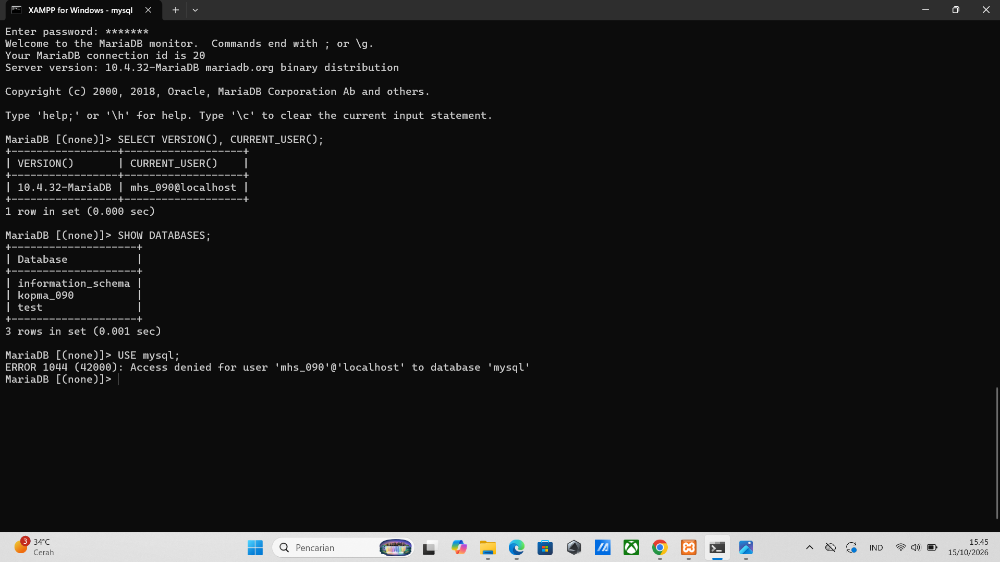
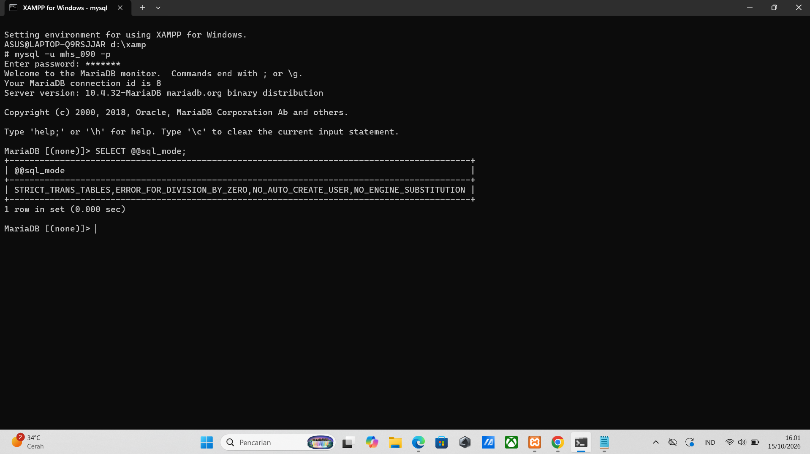
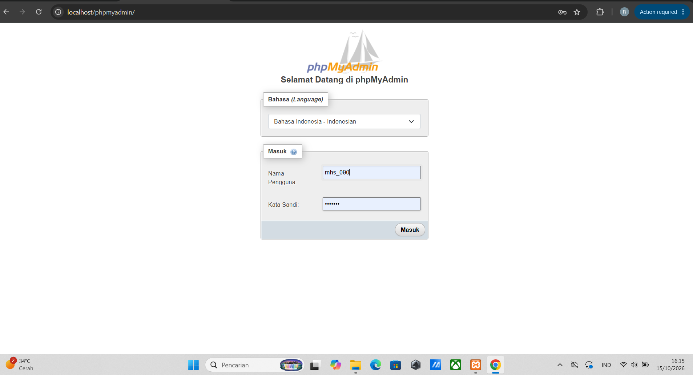
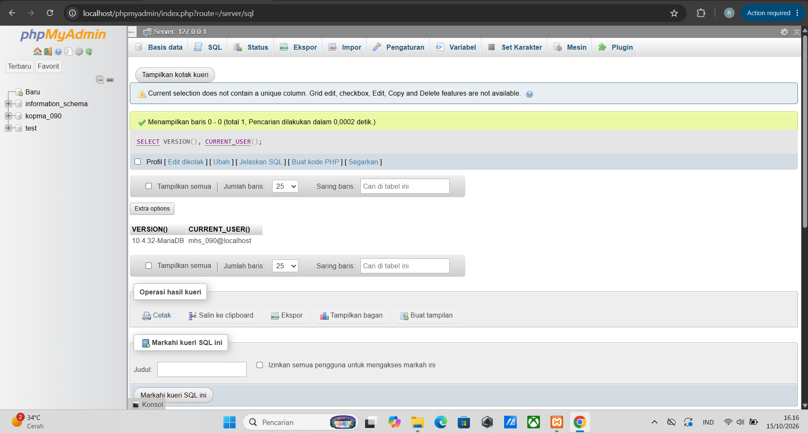
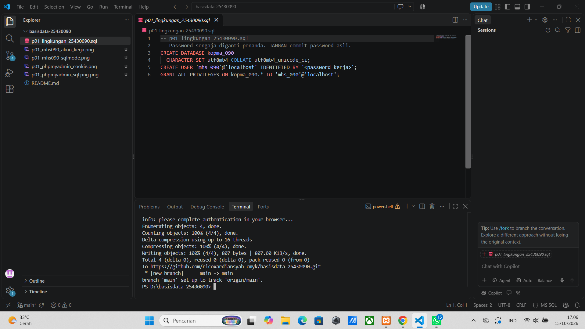
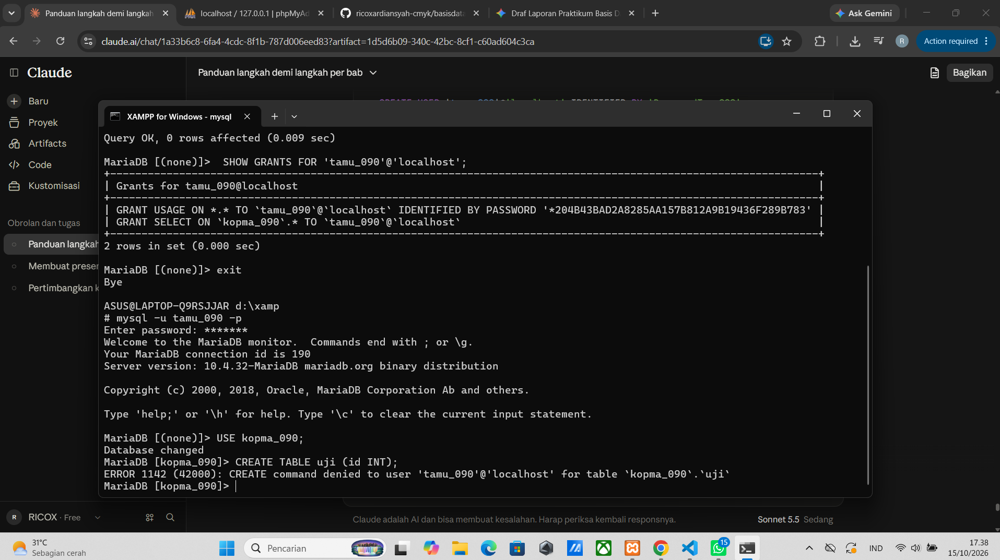
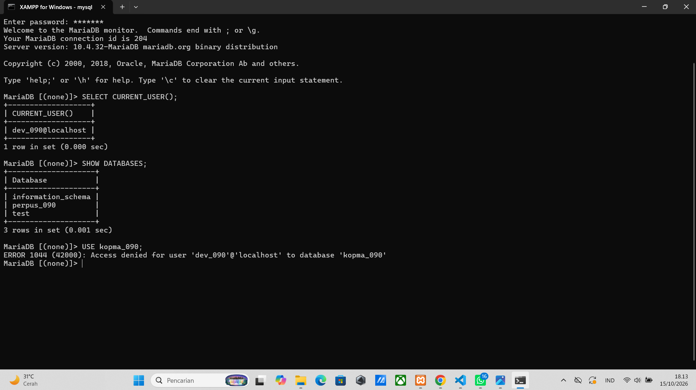

# Laporan Praktikum Basis Data - Pertemuan 01

**Nama:** Rico Ardiansyah    **NIM:** 25430090    **Kelas:** D  **Tanggal:** 15 Oktober 2026
**Dosen:** Dedi Irawan S.kom., M.T.I.

## 1. Tujuan Praktikum
Praktikum ini bertujuan untuk memahami arsitektur sistem basis data klien-server, mengoperasikan server MariaDB melalui antarmuka baris perintah (CLI) dan phpMyAdmin, serta mengelola akun pengguna beserta hak aksesnya (*privileges*).

## 2. Ringkasan Dasar Teori
Sistem basis data relasional beroperasi menggunakan arsitektur klien-server, di mana perangkat lunak server (seperti MariaDB dalam XAMPP) melayani permintaan dari berbagai klien dengan menerapkan prinsip keamanan hak akses minimum (*principle of least privilege*).

## 3. Hasil Langkah Percobaan

### 3.1 Akun kerja mhs_090: versi, akun, daftar basis data, galat 1044

Keterangan: Menampilkan pengujian koneksi menggunakan akun `mhs_090`, pengecekan versi server, identitas pengguna aktif, serta daftar basis data.

### 3.2 Mode SQL ketat

Keterangan: Pemeriksaan variabel `sql_mode` yang aktif pada sesi MariaDB saat ini.

### 3.3 phpMyAdmin mode cookie: halaman masuk

Keterangan: Tangkapan layar halaman otentikasi phpMyAdmin dengan mode *cookie*.

### 3.4 phpMyAdmin: kueri sebagai mhs_090

Keterangan: Hasil eksekusi kueri SQL sederhana di dalam antarmuka phpMyAdmin.

### 3.5 Git push pertama

Keterangan: Menampilkan proses pengunggahan berkas kerja lokal pertama kali ke GitHub.

## 4. Jawaban Titik Analisis

**Titik Analisis 1:** Konsekuensinya adalah beberapa galat atau fitur internal MariaDB mungkin memiliki perilaku berbeda dari MySQL murni, namun dokumentasi MySQL tetap relevan untuk sintaks dasar SQL standar.

**Titik Analisis 2:** Bagian pesan galat yang menunjukkan sandi tidak dikirim tertera pada bagian `using password: NO`.

**Titik Analisis 3:** `information_schema` bersifat publik untuk membaca metadata sistem. Galat 1044 muncul karena tidak memiliki izin akses basis data, sedangkan galat 1045 muncul saat autentikasi gagal.

**Titik Analisis 4:** Mode *cookie* lebih aman karena kredensial login tidak disimpan secara permanen di dalam berkas konfigurasi teks biasa (`config.inc.php`).

**Perbedaan kode galat 1044, 1045, dan 1142:** 
- **1044:** Tidak memiliki hak akses ke basis data tertentu.
- **1045:** Autentikasi login ditolak.
- **1142:** Perintah spesifik ditolak pada tabel tertentu.

## 5. Hasil Latihan dan Modifikasi

### Latihan E.1 (akun tamu_090 dengan hak SELECT saja)

Keterangan: Uji coba hak akses SELECT dan kemunculan galat 1142 saat melakukan perintah di luar hak akses.

### Latihan E.2 (skrip p01 yang dapat dijalankan berulang)
Skrip basis data dirancang dengan menyertakan klausa `DROP DATABASE IF EXISTS` agar aman dan dapat dieksekusi berulang kali.

## 6. Tugas Mandiri: Milestone Proyek 01

Keterangan: Pengujian akun `dev_090` pada MariaDB 10.4.32[cite: 2], verifikasi pengguna aktif, daftar basis data yang diizinkan (`perpus_090`, `information_schema`, `test`), serta bukti penolakan akses Galat 1044 pada basis data `kopma_090`[cite: 2].

## 7. Pembahasan dan Kendala
Kendala utama yang ditemui adalah kesalahan pengetikan (*typo*) pada perintah GRANT dan lupa menyertakan argumen `-p`. Diatasi dengan membaca pesan galat secara teliti di terminal.

## 8. Kesimpulan
Praktikum ini memberikan pemahaman mendalam mengenai manajemen pengguna dan pengamanan sistem basis data menggunakan alat bantu CLI, phpMyAdmin, serta Git.

## 9. Pernyataan Penggunaan AI
Alat AI digunakan untuk membantu memandu alur langkah praktikum, menganalisis pesan galat, serta merapikan struktur penulisan laporan.

## 10. Bukti Git
- Repositori: https://github.com/ricoxardiansyah-cmyk/basisdata-25430090
- Hash commit: `777af77`
- Pesan commit: `p01: menyelesaikan laporan dan milestone proyek basis data pertemuan 1`