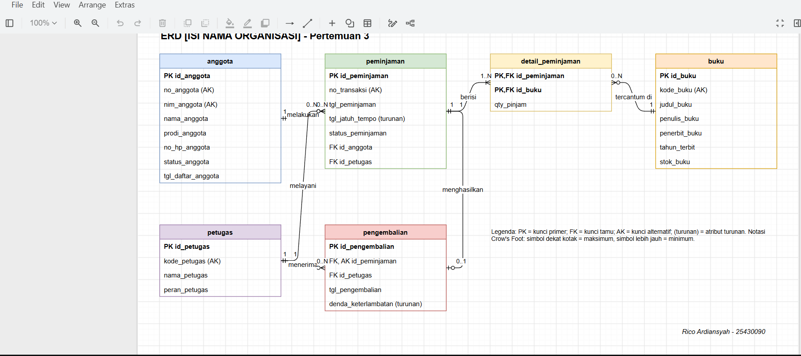
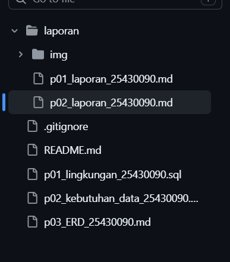

# Laporan Praktikum Basis Data - Pertemuan 03

**Nama:** Rico Ardiansyah    **NIM:** 25430090    **Kelas:** D
**Pertemuan:** 3    **Tanggal:** 16
**Dosen/Asisten:** Dedi Irawan S.kom., M.T.I.

## 1. Tujuan Praktikum

Praktikum ini bertujuan untuk memahami cara menerjemahkan dokumen kebutuhan data menjadi ERD yang terdiri dari entitas, atribut, dan relasi. Saya juga berlatih menentukan kardinalitas dan partisipasi setiap relasi dari dua arah dengan dasar aturan bisnis, memecah relasi banyak-ke-banyak menjadi entitas asosiatif, serta menguji ERD terhadap kebutuhan informasi sebelum dilanjutkan ke normalisasi.

## 2. Ringkasan Dasar Teori

Entity-Relationship Diagram (ERD) adalah gambar model konseptual data. Entitas adalah hal yang dicatat (misalnya `anggota` dan `buku`), atribut adalah sifat dari entitas (misalnya `nama_anggota` dan `judul_buku`), dan relasi adalah hubungan antar entitas yang dibaca sebagai kata kerja, misalnya "anggota melakukan peminjaman". Setiap entitas memiliki kunci primer, dan relasi diwujudkan melalui kunci tamu.

Kardinalitas menyatakan jumlah paling banyak entitas yang saling berhubungan, sedangkan partisipasi menyatakan apakah hubungan itu wajib (minimum satu) atau boleh tidak ada (minimum nol). Keduanya dibaca dari dua arah. Pada notasi Crow's Foot, simbol yang dekat dengan kotak entitas menunjukkan maksimum dan simbol yang lebih jauh menunjukkan minimum. Contohnya, satu peminjaman dimiliki tepat satu anggota, sedangkan seorang anggota dapat memiliki nol atau banyak peminjaman.

Relasi banyak-ke-banyak tidak dapat disimpan langsung dalam basis data relasional, sehingga dipecah menjadi entitas asosiatif yang menghubungkan kedua entitas melalui dua relasi satu-ke-banyak. Entitas asosiatif juga dapat menyimpan atribut milik hubungan itu sendiri. Pada proyek ini, `detail_peminjaman` menghubungkan `peminjaman` dan `buku` serta menyimpan `qty_pinjam`.

## 3. Hasil Langkah Percobaan

### 3.1 ERD proyek di draw.io

Gambar ini menampilkan ERD proyek Perpustakaan dengan enam entitas (`anggota`, `buku`, `petugas`, `peminjaman`, `detail_peminjaman`, `pengembalian`) dan enam relasi dalam notasi Crow's Foot, lengkap dengan kunci primer, kunci tamu, dan atribut turunan. Artinya, seluruh entitas dan relasi dari dokumen kebutuhan data Modul 2 sudah terwakili dalam satu diagram, dengan `detail_peminjaman` sebagai entitas asosiatif antara `peminjaman` dan `buku`.

### 3.2 Tampilan GitHub

## 4. Jawaban Titik Analisis

**Titik Analisis 1.** Mengapa `id_anggota` dipilih sebagai kunci primer padahal `no_anggota` dan `nim_anggota` sama-sama unik?

`id_anggota` dipilih karena nilainya bersifat internal dan stabil. `nim_anggota` dan `no_anggota` memang unik, tetapi keduanya bisa perlu dikoreksi, misalnya karena salah ketik saat pendaftaran atau penggantian kartu. Jika NIM dijadikan kunci primer, perubahan satu nilai itu harus diikuti di setiap tabel yang merujuknya (yaitu `peminjaman`), sehingga risiko data tidak konsisten meningkat. Kedua kolom itu tetap dijaga unik sebagai kunci alternatif (AB-05).

**Titik Analisis 2.** Aturan apa yang membuat sisi `peminjaman` ke `detail_peminjaman` bernilai satu atau banyak, dan apakah struktur tabel saja dapat menjaganya?

Sisi tersebut bernilai satu atau banyak karena setiap transaksi peminjaman harus memuat minimal satu buku (slip peminjaman, PB-02). Struktur tabel saja, yaitu kunci primer dan kunci tamu, hanya menjamin setiap baris detail merujuk satu transaksi yang ada. Struktur itu tidak dapat memaksa sebuah transaksi memiliki minimal satu baris detail. Penegakan batas minimum tersebut memerlukan mekanisme transaksi basis data, yang dibahas pada Modul 14.

**Titik Analisis 3.** Apakah ERD dapat menjawab "petugas mana yang menerima pengembalian buku"?

Bisa. Relasi "petugas menerima pengembalian" menyimpan `id_petugas` pada entitas `pengembalian`, sehingga petugas penerima dapat ditelusuri langsung dari catatan pengembalian. Jalur lewat petugas yang melayani peminjaman tidak cukup, karena petugas yang melayani peminjaman belum tentu petugas yang menerima pengembaliannya. Relasi ini ditambahkan untuk memenuhi AB-06.

## 5. Tugas Mandiri: Milestone Proyek 3

Berkas milestone: `p03_erd_25430090.md`, `p03_erd_25430090.drawio`, dan `p03_erd_25430090.png`.

**Pemetaan entitas ke proses dan kebutuhan informasi (Modul 2)**

| Entitas | Proses bisnis (PB) | Kebutuhan informasi (KI) |
|---|---|---|
| anggota | PB-01, PB-02 | KI-03 |
| buku | PB-02, PB-03, PB-04 | KI-02, KI-05 |
| petugas | PB-02, PB-03 | (tidak dipakai langsung oleh KI) |
| peminjaman | PB-02, PB-03 | KI-01, KI-02, KI-03 |
| detail_peminjaman (entitas asosiatif, memuat `qty_pinjam`) | PB-02, PB-03 | KI-02 |
| pengembalian | PB-03 | KI-01, KI-03, KI-04 |

**Alasan kardinalitas relasi utama**

- **anggota - peminjaman (1 : 0..N):** setiap transaksi pasti dimiliki satu anggota (AB-01), dan anggota yang baru mendaftar boleh belum pernah meminjam.
- **peminjaman - detail_peminjaman (1 : 1..N):** satu transaksi memuat minimal satu buku (slip peminjaman, PB-02), dan setiap baris detail hanya milik satu transaksi.
- **buku - detail_peminjaman (1 : 0..N):** buku baru dari pengadaan (PB-04) boleh belum pernah dipinjam, sehingga minimumnya nol.
- **peminjaman - pengembalian (1 : 0..1):** satu transaksi menghasilkan paling banyak satu catatan pengembalian (AB-07), dan transaksi yang belum dikembalikan belum memilikinya.
- **petugas - peminjaman dan petugas - pengembalian (1 : 0..N):** setiap transaksi dan setiap pengembalian dicatat oleh tepat satu petugas (AB-01, AB-06), sedangkan petugas baru boleh belum melayani siapa pun.

**Catatan perubahan terhadap dokumen Modul 2**

- `qty_pinjam` dipindah dari kelompok peminjaman ke entitas `detail_peminjaman`, karena jumlah dicatat per buku pada tiap transaksi.
- Pengembalian kini mencatat petugas penerima (`id_petugas`), karena AB-06 mewajibkan petugas memeriksa buku saat pengembalian.
- AB-07 dipertahankan: pengembalian dicatat per transaksi, sehingga `id_peminjaman` menjadi kunci alternatif pada `pengembalian`. Konsekuensinya sistem tidak mendukung pengembalian sebagian.
- `detail_peminjaman` memakai kunci komposit `id_peminjaman + id_buku`; buku yang sama muncul sekali per transaksi dengan jumlahnya di `qty_pinjam`.

**Keputusan yang masih terbuka:** [ISI: tulis jujur, misalnya elemen kondisi buku (AB-06) dan pemodelan pemasok atau pengadaan (PB-04) yang belum dimasukkan ke ERD.]

## 6. Pembahasan dan Kendala

**Kendala 1: membaca kardinalitas dari dua arah.** Pada awalnya saya menetapkan sisi `buku` dan `petugas` terhadap `detail_peminjaman` dan `peminjaman` sebagai "satu atau banyak", dan menganggap setiap transaksi pasti punya satu catatan pengembalian. Setelah diuji dengan kasus nyata, nilai itu keliru: buku yang baru dibeli (PB-04) dan petugas yang baru bergabung belum pernah dipakai dalam transaksi, sehingga minimumnya nol. Transaksi yang belum dikembalikan juga belum punya catatan pengembalian, sehingga sisi pengembalian bernilai nol atau satu. Saya mengatasinya dengan membaca setiap garis sebagai kalimat dari kedua arah ("untuk satu buku, berapa baris detail paling sedikit dan paling banyak?") dan mencari satu kasus nyata yang melanggar nilai minimum sebelum menetapkannya. Simbol minimum dan maksimum pada notasi Crow's Foot lalu saya cocokkan dengan tabel relasi.

**Kendala 2: membuka berkas ERD.** Berkas `.drawio` awalnya terbuka di Microsoft Word karena belum ada aplikasi yang terhubung ke ekstensi tersebut. Saya mengatasinya dengan membuka berkas lewat app.diagrams.net dan memasang ekstensi Draw.io Integration di VS Code, sehingga diagram dapat diedit dan diekspor menjadi PNG.

## 7. Kesimpulan

Pada Pertemuan 3 saya menyusun ERD proyek Perpustakaan dengan enam entitas (`anggota`, `buku`, `petugas`, `peminjaman`, `detail_peminjaman`, `pengembalian`) dan enam relasi. Setiap relasi dan kardinalitasnya saya tetapkan berdasarkan aturan bisnis atau proses bisnis dari dokumen kebutuhan data Modul 2, sehingga setiap garis pada ERD dapat ditelusuri ke dasarnya, dan relasi yang tidak punya dasar berarti hanya tebakan. ERD juga saya uji terhadap lima kebutuhan informasi (KI-01 sampai KI-05); semuanya dapat ditelusuri lewat jalur entitas yang valid, sehingga rancangan siap dilanjutkan ke normalisasi pada Modul 4. Proses ini menunjukkan bahwa kardinalitas harus diuji dengan kasus nyata dari dua arah, dan bahwa perubahan terhadap dokumen Modul 2 perlu dicatat, bukan dihapus diam-diam.

## 8. Pernyataan Penggunaan AI

Pada Pertemuan 3 saya menggunakan Claude (Anthropic) untuk:

1. Menjelaskan konsep ERD, kardinalitas, partisipasi, kunci tamu, dan entitas asosiatif.
2. Memandu langkah penyusunan relasi lewat pertanyaan pilihan. Keputusan relasi, kardinalitas, dan kunci saya tetapkan sendiri berdasarkan dokumen kebutuhan data Modul 2. Claude mengoreksi jawaban yang tidak konsisten dengan aturan bisnis saya, misalnya sisi "nol atau banyak" pada buku dan petugas, serta sisi "nol atau satu" pada pengembalian.
3. Membuat kerangka berkas ERD, kerangka laporan, dan berkas draw.io awal dari keputusan tersebut. Berkas itu saya periksa dan sesuaikan sendiri.
4. Memeriksa jalur penelusuran kebutuhan informasi dan kesalahan penulisan pada berkas.

Jawaban Titik Analisis saya pilih sendiri dari opsi yang diajukan Claude berdasarkan analisis proyek saya, lalu kalimat laporannya dirapikan oleh Claude. Pembahasan kendala dan kesimpulan saya pilih dari poin yang saya alami dan ajukan, lalu dirapikan oleh Claude.

## 9. Bukti Git

- **Tautan repositori:** https://github.com/ricoxardiansyah-cmyk/basisdata-25430090
- **Hash commit:** '910aa62'

## Checklist (centang hanya yang benar-benar ada di repositori)

| ☐ | Butir |
|---|---|
| ☐ | Identitas lengkap (nama, NIM, kelas, pertemuan, tanggal, dosen/asisten) |
| ☐ | Tujuan dan ringkasan teori dengan bahasa sendiri |
| ☐ | Langkah percobaan dengan tangkapan layar dan keterangan |
| ☐ | Semua Titik Analisis dijawab dengan alasan |
| ☐ | Latihan E dengan bukti (atau dinyatakan jujur belum selesai) |
| ☐ | Milestone 3: ERD, tabel relasi dan kardinalitas, penelusuran KI, entitas asosiatif, catatan tinjauan klien |
| ☐ | `p03_erd_25430090` (berkas `.md`, `.drawio`, dan `.png`) |
| ☐ | ERD memuat judul organisasi, legenda, dan tanda tangan digital (nama + NIM) |
| ☐ | Pemetaan entitas ke PB atau KI dari Pertemuan 2 |
| ☐ | Pembahasan, kesimpulan, dan Pernyataan Penggunaan AI |
| ☐ | Bukti Git: tautan repositori dan hash commit |