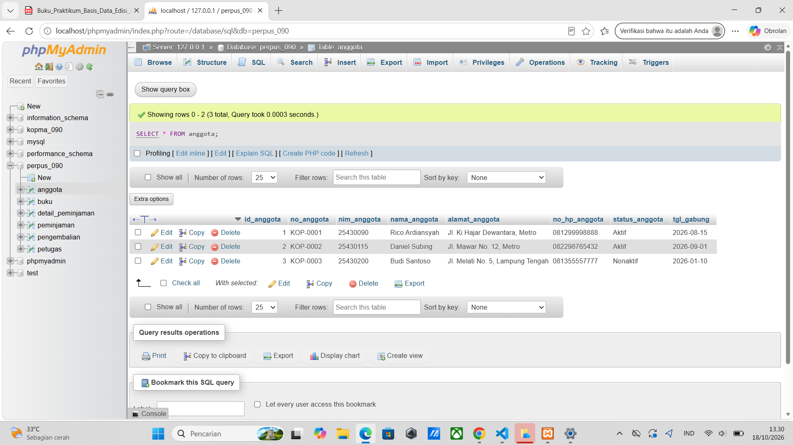
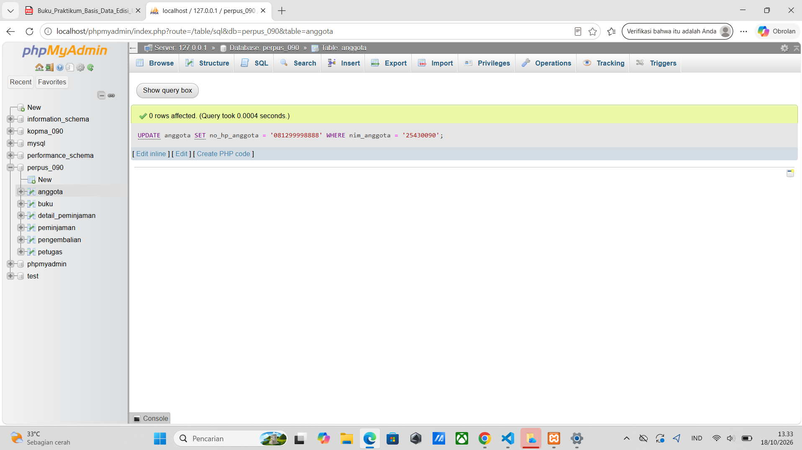
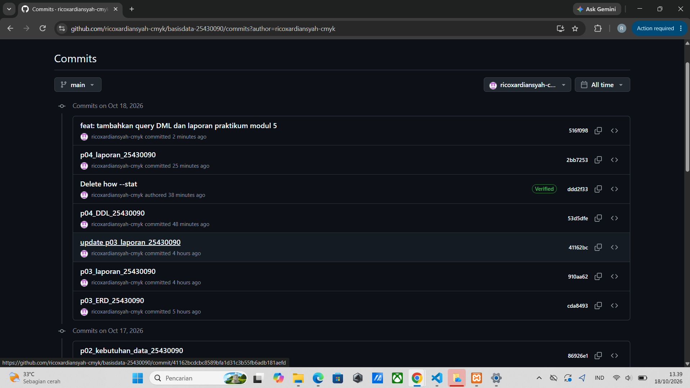

# Laporan Praktikum Basis Data - Pertemuan 05
* **Nama:** Rico Ardiansyah
* **NPM / NIM:** 25430090
* **Kelas:** D
* **Pertemuan:** 5
* **Tanggal Pelaksanaan:** Oktober 2026
* **Dosen Pengampu:** Dedi Irawan, S.Kom., M.T.I.

---

## 1. Tujuan Praktikum
1. Memahami dan mengimplementasikan sintaks Data Manipulation Language (DML) untuk mengelola rekaman data pada basis data fisik.
2. Memasukkan (*insert*) sekumpulan data awal ke dalam tabel master dan tabel transaksi secara berurutan guna menjaga integritas *Foreign Key*.
3. Melakukan pembaruan (*update*) dan penghapusan (*delete*) data dengan menggunakan klausa kondisional (`WHERE`).
4. Membuktikan relasi dan batasan referensial (seperti *ON DELETE RESTRICT*) berfungsi dengan baik saat terjadi manipulasi data antar tabel yang berelasi.

## 2. Ringkasan Dasar Teori
Data Manipulation Language (DML) adalah sekumpulan perintah SQL yang digunakan untuk berinteraksi dengan isi dari tabel-tabel di dalam basis data. Perintah inti DML terdiri dari `INSERT` untuk menambah baris data baru, `UPDATE` untuk memodifikasi baris data yang sudah ada, `DELETE` untuk menghapus baris data, dan `SELECT` untuk menampilkan data. Dalam basis data relasional yang menerapkan *Foreign Key*, urutan eksekusi DML sangat krusial; data pada tabel induk (seperti anggota dan buku) harus di-*insert* lebih dahulu sebelum dapat dirujuk oleh tabel anak (seperti tabel transaksi peminjaman).

## 3. Langkah Percobaan (D)
Penyusunan kode perintah DML untuk proyek Perpustakaan (`perpus_090`) telah ditulis dan diunggah ke dalam repositori GitHub. Eksperimen mencakup penyisipan data ke dalam 6 tabel utama, mengeksekusi pengurangan stok menggunakan operator aritmatika pada `UPDATE`, serta mendemonstrasikan penghapusan data `buku` dengan aman.

**Bukti Tangkapan Layar Eksekusi DML:**
1. **Bukti Data Berhasil Dimasukkan (SELECT Tabel Anggota/Transaksi)**
   

2. **Bukti Keberhasilan Manipulasi Data (UPDATE & DELETE)**
   

3. **Bukti Sinkronisasi GitHub Modul 5**
   
   
## 4. Titik Analisis
### Jawaban Titik Analisis Modul 5
1. **Mengapa pengisian (INSERT) data tidak boleh dimulai dari tabel `peminjaman`?**  
   Tabel `peminjaman` merupakan tabel anak (transaksi) yang memiliki *Foreign Key* merujuk pada `id_anggota` (tabel anggota) dan `id_petugas` (tabel petugas). Jika tabel `peminjaman` diisi lebih dulu, RDBMS akan menolak (error) karena ID anggota atau petugas yang dicantumkan dalam transaksi tersebut belum eksis di tabel induknya.
2. **Apa fungsi klausa `WHERE` pada perintah `UPDATE` dan `DELETE`?**  
   Klausa `WHERE` berfungsi sebagai filter penentu kondisi spesifik baris mana yang akan diubah atau dihapus. Jika perintah `UPDATE` atau `DELETE` dieksekusi tanpa `WHERE`, RDBMS akan memperbarui atau menghapus seluruh baris di dalam tabel tersebut (efek sapu jagat), yang dapat mengakibatkan hilangnya data operasional secara fatal.
3. **Mengapa sistem akan menolak jika kita mencoba menghapus (*DELETE*) anggota bernama 'Rico Ardiansyah'?**  
   Karena 'Rico Ardiansyah' telah memiliki riwayat di tabel `peminjaman` (ID-nya direferensikan). Berkat batasan `ON DELETE RESTRICT` yang diatur pada Modul 4, MySQL mencegah penghapusan data induk selama data tersebut masih memiliki jejak di tabel anak, guna mencegah timbulnya *orphan records* (data transaksi tanpa pemilik).

## 5. Tugas Mandiri: Milestone Proyek 5 (F)
Dokumentasi sintaks DML basis data perpustakaan (`perpus_090`) diunggah pada repositori dengan nama file `p05_DML_25430090.sql`. Keseluruhan struktur mencakup:
* Tiga blok `INSERT` untuk tabel master (Anggota, Buku, Petugas).
* Tiga blok `INSERT` untuk alur transaksi (Peminjaman, Detail Peminjaman, Pengembalian).
* `UPDATE` untuk simulasi pengurangan stok buku dan pembaruan profil anggota.
* `DELETE` bersyarat untuk menghapus katalog buku usang.

## 6. Pembahasan dan Kendala
* **Kendala yang Ditemui:** Menghadapi *Error Code: 1452 (Cannot add or update a child row: a foreign key constraint fails)* saat mencoba meng-insert data rincian peminjaman buku yang `id_buku`-nya belum dimasukkan ke tabel master buku.
* **Cara Mengatasi:** Melakukan pengecekan ID yang valid melalui perintah `SELECT * FROM buku`. Setelah memastikan ID yang dipanggil dalam tabel `detail_peminjaman` benar-benar ada di tabel master, *query* `INSERT` dieksekusi ulang dan berhasil diproses.

## 7. Kesimpulan
Operasi manipulasi data (DML) berhasil diimplementasikan pada skema fisik Perpustakaan Cendekia (`perpus_090`). Praktikum ini membuktikan bahwa rancangan ERD dan deklarasi *constraint* yang tepat pada modul sebelumnya mampu melindungi basis data dari inkonsistensi, memaksa pengguna mengikuti hierarki pengisian data yang valid (dari entitas *master* ke *transaction*).

## 8. Pernyataan Penggunaan AI
Asisten AI (Gemini) digunakan dalam praktikum ini sebagai sarana peninjauan logika urutan eksekusi *query* hierarkis untuk menghindari bentrok *Foreign Key*, serta penyusunan format penulisan laporan. Keseluruhan kode DML dan langkah eksekusi repositori Git dilakukan secara mandiri.

## 9. Bukti Git
* **Tautan Repositori:** https://github.com/ricoxardiansyah-cmyk/basisdata-25430090
* **Kode Commit (Hash):** 2caa86b

---

### Checklist Laporan Praktikum (Modul 5)
| Butir | Yang Harus Ada | Status |
| :--- | :--- | :---: |
| **Identitas** | Nama, NPM, kelas, pertemuan ke-5, tanggal pelaksanaan, dosen | [x] |
| **Tujuan** | Tujuan praktikum DML ditulis ulang dengan bahasa sendiri | [x] |
| **Ringkasan teori** | Pemahaman mandiri atas perintah INSERT, UPDATE, DELETE | [x] |
| **Langkah Percobaan** | Penjelasan struktur file DML di repositori GitHub | [x] |
| **Titik Analisis** | Jawaban hierarki insert data, fungsi WHERE, efek FK Restrict | [x] |
| **Tugas Mandiri** | Berkas kode SQL (`.sql`) lengkap dengan CRUD data fiktif | [x] |
| **Kesimpulan & AI** | Kesimpulan ringkas dan pernyataan penggunaan AI | [x] |
| **Bukti Git** | Tautan repositori dan kode commit hash DML | [x] |