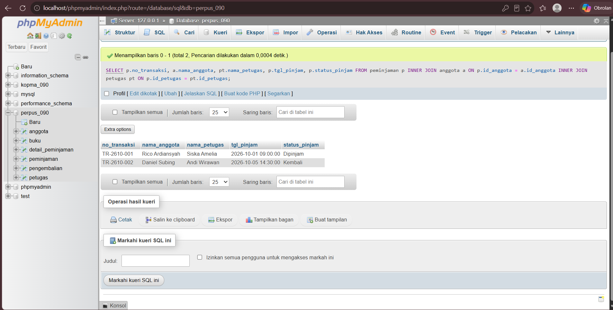

# Laporan Praktikum Basis Data - Pertemuan 06
* **Nama:** Rico Ardiansyah
* **NPM / NIM:** 25430090
* **Kelas:** D
* **Pertemuan:** 6
* **Tanggal Pelaksanaan:** Oktober 2026
* **Dosen Pengampu:** Dedi Irawan, S.Kom., M.T.I.

---

## 1. Tujuan Praktikum
1. Mengimplementasikan Data Query Language (DQL) tingkat lanjut untuk mengekstrak informasi yang relevan dari basis data.
2. Memahami dan mempraktikkan penggabungan data antar tabel menggunakan klausa `INNER JOIN` dan `LEFT JOIN`.
3. Menggunakan fungsi agregasi (`SUM`, `COUNT`) yang dikombinasikan dengan klausa `GROUP BY` untuk menghasilkan data statistik.
4. Menerjemahkan Kebutuhan Informasi (KI) yang dirancang pada Modul 2 menjadi kueri SQL nyata.

## 2. Ringkasan Dasar Teori
Dalam basis data relasional, data didistribusikan ke dalam beberapa tabel terpisah untuk menghindari redundansi. Untuk merangkai kembali informasi yang utuh, digunakan teknik *JOIN*. `INNER JOIN` akan menampilkan baris data yang memiliki kecocokan di kedua tabel (irisan), sedangkan `LEFT JOIN` akan menampilkan seluruh baris dari tabel kiri beserta data pasangannya dari tabel kanan (jika tidak ada pasangan, bernilai *NULL*). Pengolahan tingkat lanjut menggunakan klausa `GROUP BY` memungkinkan pengelompokan baris yang memiliki nilai sama ke dalam data ringkasan, yang sering dipasangkan dengan fungsi agregasi seperti `SUM` (total nilai) atau `COUNT` (jumlah baris).

## 3. Langkah Percobaan (D)
Berkas kueri `p06_DQL_25430090.sql` telah disusun dan dieksekusi untuk menjawab Kebutuhan Informasi (KI) sistem perpustakaan. Tangkapan layar di bawah ini memverifikasi bahwa kueri relasional (JOIN) antar tabel *anggota*, *peminjaman*, dan *buku* berfungsi menghasilkan keluaran laporan terintegrasi.

**Bukti Tangkapan Layar Eksekusi JOIN:**
*(Silakan tambahkan screenshot hasil eksekusi kueri INNER JOIN atau GROUP BY dari phpMyAdmin di sini, lalu simpan fotonya di `img/p06_join.png`)*

## 4. Titik Analisis
### Jawaban Titik Analisis Modul 6
1. **Apa perbedaan spesifik hasil antara penggunaan `INNER JOIN` dan `LEFT JOIN` pada kueri peminjaman buku?**  
   Jika menggunakan `INNER JOIN` antara tabel `buku` dan `detail_peminjaman`, sistem hanya akan menampilkan buku yang **sudah pernah** dipinjam. Namun, jika menggunakan `LEFT JOIN` (dengan tabel `buku` di posisi kiri), sistem akan menampilkan **seluruh katalog buku**, termasuk buku baru yang sama sekali belum pernah dipinjam (kolom rincian pinjamnya akan bernilai *NULL*).
2. **Mengapa fungsi `SUM()` atau `COUNT()` mewajibkan penggunaan klausa `GROUP BY` ketika menampilkan kolom non-agregasi (seperti nama atau judul)?**  
   Fungsi agregasi mengubah banyak baris menjadi satu nilai hitungan tunggal. Jika kita menampilkan kolom biasa (misal `judul_buku`) bersamaan dengan `SUM(qty_pinjam)`, RDBMS kebingungan baris mana yang harus mewakili total tersebut. `GROUP BY` memberikan instruksi kepada sistem untuk menghitung total tersebut **per masing-masing kategori** (per judul buku).
3. **Bagaimana kueri KI-03 mendeteksi anggota yang terlambat?**  
   Kueri membandingkan nilai `tgl_jatuh_tempo` dengan fungsi tanggal dinamis `CURRENT_DATE`. Jika tanggal jatuh tempo lebih kecil dari hari ini, dan `status_pinjam` masih tercatat 'Dipinjam', maka transaksi tersebut difilter sebagai pelanggaran/keterlambatan.

## 5. Tugas Mandiri: Milestone Proyek 6 (F)
Dokumentasi sintaks DQL berbasis *JOIN* telah diunggah dengan nama `p06_DQL_25430090.sql`. File ini memuat penyelesaian untuk KI-02 (buku terlaris), KI-03 (keterlambatan), dan KI-04 (total denda), membuktikan bahwa rancangan konseptual ERD dapat direalisasikan ke dalam laporan operasional nyata.

## 6. Pembahasan dan Kendala
* **Kendala:** Saat melakukan penggabungan 3 tabel (Peminjaman, Anggota, dan Petugas), muncul peringatan *ambiguous column name* ketika memanggil `id_anggota` tanpa *alias*.
* **Solusi:** Menambahkan alias tabel pada klausa `SELECT` (misalnya menyebutkan secara eksplisit `p.id_anggota` atau `a.id_anggota`) untuk memperjelas dari tabel mana kolom tersebut harus ditarik oleh sistem.

## 7. Kesimpulan
Modul 6 berhasil membuktikan kapabilitas basis data relasional. Pemecahan data ke dalam berbagai entitas yang dilakukan pada tahap normalisasi dan DDL tidak menghilangkan konteks informasi berkat penerapan operasi relasional *JOIN*. Sistem Perpustakaan Cendekia kini mampu menghasilkan laporan analitik (buku terlaris, rekap denda) secara instan.

## 8. Pernyataan Penggunaan AI
Asisten AI (Gemini) digunakan untuk memandu penulisan logika filter kalender (`CURRENT_DATE`) serta format laporan standar Git. Keseluruhan rancangan struktur relasional dan uji coba kueri SQL dijalankan mandiri di atas peramban lokal.

## 9. Bukti Git
* **Tautan Repositori:** https://github.com/ricoxardiansyah-cmyk/basisdata-25430090
* **Kode Commit (Hash):** *[Silakan isi dengan hash terbaru Anda]*

---

### Checklist Laporan Praktikum (Modul 6)
| Butir | Yang Harus Ada | Status |
| :--- | :--- | :---: |
| **Identitas** | Nama, NPM, kelas, pertemuan ke-6 | [x] |
| **Tujuan** | Tujuan penggunaan JOIN dan DQL | [x] |
| **Ringkasan teori** | Pemahaman INNER JOIN, LEFT JOIN, GROUP BY | [x] |
| **Langkah Percobaan** | Penjelasan file SQL dan gambar bukti eksekusi | [x] |
| **Titik Analisis** | Jawaban perbedaan INNER/LEFT, fungsi agregasi | [x] |
| **Tugas Mandiri** | Kueri penyelesaian KI-02, KI-03, dan KI-04 | [x] |
| **Kesimpulan & Bukti Git** | Kesimpulan utuh dan tautan repositori dengan Hash | [x] |