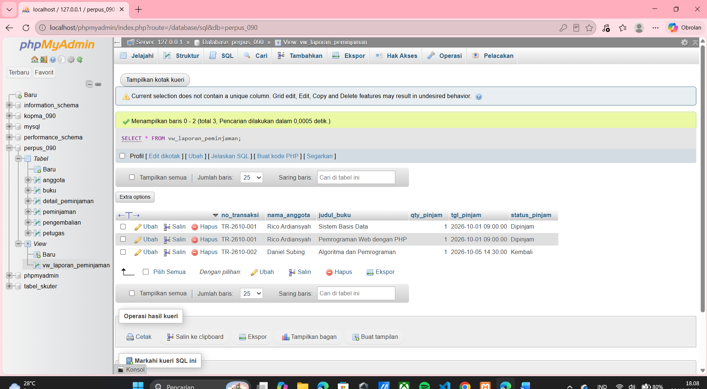

# Laporan Praktikum Basis Data - Pertemuan 07
* **Nama:** Rico Ardiansyah
* **NPM / NIM:** 25430090
* **Kelas:** D
* **Pertemuan:** 7
* **Tanggal Pelaksanaan:** Oktober 2026
* **Dosen Pengampu:** Dedi Irawan, S.Kom., M.T.I.

---

## 1. Tujuan Praktikum
1. Memahami konsep dan kegunaan *View* sebagai tabel virtual untuk menyederhanakan kueri relasional yang kompleks.
2. Mampu membuat, memanggil, dan memodifikasi *View* dalam basis data MySQL.
3. Memahami konsep *Subquery* (kueri bersarang) untuk menyaring data berdasarkan hasil dari kueri lain.
4. Mengimplementasikan *Subquery* dengan klausa `IN`, `NOT IN`, dan pencarian nilai skalar tunggal (seperti nilai maksimum/terbanyak).

## 2. Ringkasan Dasar Teori
* **View** adalah tabel virtual yang isinya dihasilkan dari eksekusi kueri `SELECT`. *View* tidak menyimpan data fisik secara mandiri, melainkan merujuk pada tabel dasar (*base table*). Keuntungannya adalah keamanan (menyembunyikan kolom sensitif) dan penyederhanaan pemanggilan kueri kompleks (seperti *JOIN* multi-tabel) karena pengguna cukup melakukan `SELECT * FROM nama_view`.
* **Subquery** adalah kueri SQL yang berada di dalam kueri SQL lainnya (biasanya di dalam klausa `WHERE`, `HAVING`, atau `FROM`). *Subquery* dieksekusi lebih dahulu oleh sistem, dan hasilnya digunakan sebagai kriteria atau data referensi oleh kueri utama (*outer query*).

## 3. Langkah Percobaan (D)
Implementasi *View* dan *Subquery* telah ditulis pada file `p07_View_Subquery_25430090.sql`. Pada tahap ini, diciptakan sebuah *View* bernama `vw_laporan_peminjaman` untuk membungkus penggabungan 4 tabel (Peminjaman, Anggota, Detail, Buku). Selanjutnya, diuji coba pencarian buku yang belum laku serta anggota teraktif menggunakan *Subquery*.

**Bukti Tangkapan Layar Eksekusi View:**
*(Tambahkan gambar hasil kueri SELECT * FROM vw_laporan_peminjaman di sini)*

## 4. Titik Analisis
### Jawaban Titik Analisis Modul 7
1. **Mengapa kita membutuhkan VIEW jika kita sudah bisa menggunakan JOIN?**  
   *JOIN* seringkali menghasilkan sintaks yang sangat panjang dan rentan kesalahan ketik jika harus diketik berulang kali. *VIEW* merangkum sintaks *JOIN* tersebut secara permanen di dalam *database*. Programmer cukup memanggil nama *View* tersebut dengan kueri pendek, sehingga pengembangan aplikasi jauh lebih efisien.
2. **Kapan waktu yang tepat menggunakan SUBQUERY `NOT IN`?**  
   `NOT IN` sangat efektif untuk membandingkan eksistensi data antar entitas (mencari data yang belum berelasi). Contoh pada sistem ini: memfilter daftar `id_buku` dari tabel induk (`buku`) yang **tidak ada** di dalam daftar `id_buku` pada tabel transaksi (`detail_peminjaman`).
3. **Apakah VIEW dapat di-UPDATE (dimanipulasi datanya)?**  
   Tergantung strukturnya. *Updatable View* hanya berlaku jika *View* merujuk pada satu tabel dasar tanpa adanya fungsi agregasi, `GROUP BY`, atau *DISTINCT*. Karena `vw_laporan_peminjaman` menggunakan *JOIN* dari 4 tabel yang berbeda, operasi DML langsung (seperti *INSERT* atau *UPDATE*) pada *View* ini dilarang oleh RDBMS.

## 5. Tugas Mandiri: Milestone Proyek 7 (F)
Dokumentasi sintaks pembentukan tabel virtual (View) dan logika bersarang (Subquery) telah diamankan pada repositori Git. Kueri terbukti efisien untuk menghasilkan rincian transaksi perpustakaan tanpa mengorbankan performa *server* saat pemanggilan data berulang.

## 6. Pembahasan dan Kendala
* **Kendala:** *Error "View already exists"* saat mencoba mengubah kolom yang ingin ditampilkan di dalam *View*.
* **Solusi:** Alih-alih menggunakan `CREATE VIEW`, perintah harus diubah menjadi `CREATE OR REPLACE VIEW` atau mengeksekusi `DROP VIEW` terlebih dahulu sebelum membuat ulang strukturnya.

## 7. Kesimpulan
Modul 7 melengkapi kemampuan manipulasi *database* dengan teknik abstraksi (*View*) dan pemfilteran dinamis (*Subquery*). Perpustakaan Cendekia (`perpus_090`) kini memiliki arsitektur *query* tingkat lanjut yang siap dihubungkan ke bahasa pemrograman (PHP/Python) dengan lebih ringkas.

## 8. Pernyataan Penggunaan AI
Asisten AI (Gemini) digunakan sebagai rekan diskusi (*thought partner*) untuk meninjau struktur pembuatan *View* dan optimalisasi logika pemanggilan *Subquery* guna mengantisipasi kelebihan beban server. Integrasi Git dilakukan mandiri.

## 9. Bukti Git
* **Tautan Repositori:** https://github.com/ricoxardiansyah-cmyk/basisdata-25430090
* **Kode Commit (Hash):** *[Silakan isi dengan hash terbaru Anda]*

---

### Checklist Laporan Praktikum (Modul 7)
| Butir | Yang Harus Ada | Status |
| :--- | :--- | :---: |
| **Identitas** | Nama, NPM, kelas, pertemuan ke-7 | [x] |
| **Tujuan** | Konsep View dan Subquery | [x] |
| **Ringkasan teori** | Tabel virtual dan kueri bersarang | [x] |
| **Langkah Percobaan** | Gambar bukti pemanggilan View | [x] |
| **Titik Analisis** | Jawaban urgensi View dan logika NOT IN | [x] |
| **Tugas Mandiri & Kesimpulan** | Uraian penutup lengkap | [x] |
| **Bukti Git** | Hash commit dan tautan | [x] |