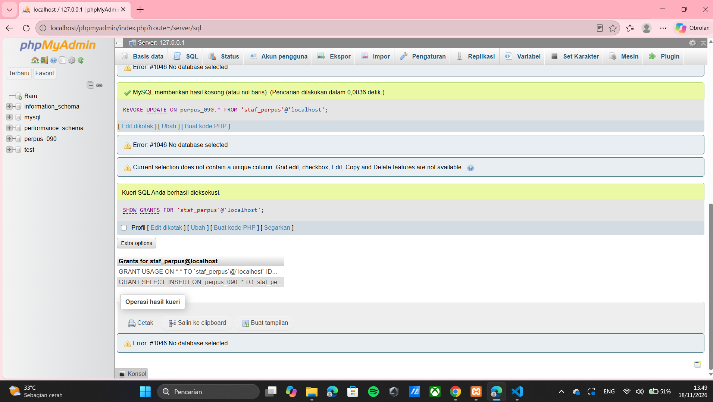

# Laporan Praktikum Basis Data - Pertemuan 09
* **Nama:** Rico Ardiansyah
* **NPM / NIM:** 25430090
* **Kelas:** D
* **Pertemuan:** 9
* **Tanggal Pelaksanaan:** November 2026
* **Dosen Pengampu:** Dedi Irawan, S.Kom., M.T.I.

---

## 1. Tujuan Praktikum
1. Memahami konsep Data Control Language (DCL) untuk manajemen keamanan basis data.
2. Mampu membuat pengguna (*user*) baru pada server MySQL.
3. Mampu memberikan hak akses (*privileges*) secara spesifik menggunakan perintah `GRANT`.
4. Mampu mencabut hak akses yang telah diberikan menggunakan perintah `REVOKE`.

## 2. Ringkasan Dasar Teori
Data Control Language (DCL) adalah subset dari perintah SQL yang digunakan untuk mengontrol akses terhadap data di dalam basis data. DCL sangat krusial dalam arsitektur sistem multi-pengguna. 
* **CREATE USER:** Membuat identitas kredensial baru untuk masuk ke server basis data.
* **GRANT:** Memberikan wewenang spesifik (seperti SELECT, INSERT, UPDATE, DELETE, atau ALL PRIVILEGES) kepada pengguna tertentu untuk database atau tabel tertentu.
* **REVOKE:** Menarik kembali wewenang yang sebelumnya telah diberikan.
* **FLUSH PRIVILEGES:** Memuat ulang tabel izin di MySQL agar perubahan hak akses langsung diterapkan tanpa perlu *restart* server.

## 3. Langkah Percobaan (D)
Praktikum ini menyimulasikan pembagian otorisasi pada sistem `perpus_090`. Akun `root` (sebagai *Database Administrator*) membuat akun baru bernama `staf_perpus`. Akun staf tersebut awalnya diberikan hak `SELECT`, `INSERT`, dan `UPDATE`. Namun, melalui perintah DCL, hak `UPDATE` kemudian dicabut kembali demi alasan keamanan sistem.

**Bukti Tangkapan Layar Eksekusi DCL:**
*(Tambahkan gambar hasil eksekusi SHOW GRANTS dari phpMyAdmin di sini)*

## 4. Titik Analisis
### Jawaban Titik Analisis Modul 9
1. **Mengapa staf perpustakaan sebaiknya tidak diberikan *ALL PRIVILEGES*?**  
   *ALL PRIVILEGES* mencakup hak untuk melakukan `DROP` (menghapus keseluruhan tabel atau basis data) dan memanipulasi *user* lain. Memberikan hak ini kepada staf biasa berisiko memunculkan kerusakan sistem yang fatal (baik disengaja maupun tidak sengaja, *human error*). Prinsip keamanannya adalah *Principle of Least Privilege* (berikan hak seminimal mungkin sesuai kebutuhan tugas).
2. **Apa yang terjadi jika *user* `staf_perpus` mencoba menjalankan perintah `DELETE FROM buku;`?**  
   Server MySQL akan menolak eksekusi tersebut dan mengeluarkan pesan galat *(Error: Access denied)* karena akun `staf_perpus` tidak memiliki izin `DELETE` dalam daftar *GRANTS*-nya.
3. **Mengapa penulisan tabel menggunakan format `perpus_090.*`?**  
   Tanda asterisk (`*`) bertindak sebagai *wildcard*. Sintaks `perpus_090.*` berarti hak akses yang diberikan berlaku untuk **seluruh tabel** yang ada di dalam *database* `perpus_090`. Jika ingin membatasi hanya pada tabel buku, sintaksnya menjadi `perpus_090.buku`.

## 5. Tugas Mandiri: Milestone Proyek 9 (F)
Skrip manajemen keamanan basis data telah diunggah ke repositori GitHub pada berkas `p09_DCL_25430090.sql`. Proyek Perpustakaan Cendekia kini telah memenuhi standar keamanan akses multi-tingkat.

## 6. Pembahasan dan Kendala
* **Kendala:** Pengguna baru (`staf_perpus`) berhasil dibuat, namun saat mencoba masuk (*login*) melalui terminal baru, akses ditolak karena lupa mengeksekusi `FLUSH PRIVILEGES;`.
* **Solusi:** `FLUSH PRIVILEGES;` wajib dijalankan setelah melakukan modifikasi pada tabel perizinan pengguna (khususnya jika diubah secara paksa) agar MySQL me-muat ulang konfigurasi keamanan.

## 7. Kesimpulan
Modul 9 berhasil membuktikan bahwa RDBMS modern seperti MySQL memiliki fitur lapisan keamanan (*security layer*) yang tangguh. Melalui perintah DCL (GRANT dan REVOKE), seorang Database Administrator (DBA) memegang kendali penuh atas siapa saja yang berhak melihat dan memanipulasi data operasional perpustakaan, mencegah kebocoran maupun kerusakan data.

## 8. Pernyataan Penggunaan AI
Asisten AI (Gemini) digunakan untuk meninjau struktur pembuatan sintaks *GRANT* dan merumuskan analisis terkait *Principle of Least Privilege*. Eksekusi *query* dan kompilasi *log* ke dalam Git dilakukan secara mandiri.

## 9. Bukti Git
* **Tautan Repositori:** https://github.com/ricoxardiansyah-cmyk/basisdata-25430090
* **Kode Commit (Hash):** * [ad84fb3 ]*

---

### Checklist Laporan Praktikum (Modul 9)
| Butir | Yang Harus Ada | Status |
| :--- | :--- | :---: |
| **Identitas** | Nama, NPM, kelas, pertemuan ke-9 | [x] |
| **Tujuan** | Konsep DCL, GRANT, dan REVOKE | [x] |
| **Ringkasan teori** | Penjelasan wewenang akses database | [x] |
| **Langkah Percobaan** | Gambar bukti hak akses (SHOW GRANTS) | [x] |
| **Titik Analisis** | Keamanan Least Privilege dan batasan aksi | [x] |
| **Tugas Mandiri & Kesimpulan** | Uraian penutup keamanan data | [x] |
| **Bukti Git** | Hash commit dan tautan | [x] |